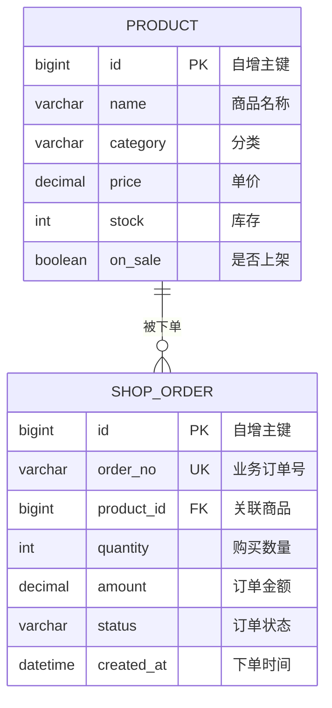

# 数据库设计文档（Kitty 主题女性垂类内容带货电商系统）

第 04 周实现的一条完整业务流程为 **商品下单流程**，涉及两张业务表：商品表 `product` 与订单表 `shop_order`。
表结构由 Spring Data JPA（Hibernate）根据实体自动生成，`spring.jpa.hibernate.ddl-auto=update`。

## 一、实体关系

一个商品可以被多个订单购买，一个订单只对应一个商品，因此 **商品 1 : N 订单**。

## 二、表结构

### 1. product（商品表）

| 字段 | 类型 | 约束 | 说明 |
| --- | --- | --- | --- |
| id | BIGINT | PRIMARY KEY, AUTO_INCREMENT | 商品主键 |
| name | VARCHAR(100) | NOT NULL | 商品名称 |
| category | VARCHAR(20) | NOT NULL | 分类：美妆 / 服饰 / 母婴 |
| price | DECIMAL(10,2) | NOT NULL | 商品单价，金额用定点数避免精度丢失 |
| stock | INT | NOT NULL | 可售库存 |
| on_sale | BOOLEAN | NOT NULL | 是否上架，下架商品不可下单 |

### 2. shop_order（订单表）

| 字段 | 类型 | 约束 | 说明 |
| --- | --- | --- | --- |
| id | BIGINT | PRIMARY KEY, AUTO_INCREMENT | 订单主键 |
| order_no | VARCHAR(32) | NOT NULL, UNIQUE (`uk_order_no`) | 业务订单号，全局唯一 |
| product_id | BIGINT | NOT NULL, FOREIGN KEY (`fk_order_product`) → product(id) | 关联的商品 |
| quantity | INT | NOT NULL | 购买数量 |
| amount | DECIMAL(12,2) | NOT NULL | 订单金额 = 单价 × 数量 |
| status | VARCHAR(16) | NOT NULL | 订单状态：CREATED / PAID / CANCELLED |
| created_at | DATETIME | NOT NULL | 下单时间 |

## 三、必要约束说明

- **主键**：两张表均使用自增主键 `id`，保证记录唯一可定位。
- **唯一约束**：`shop_order.order_no` 加唯一约束 `uk_order_no`，防止重复订单号。
- **外键约束**：`shop_order.product_id` 外键关联 `product.id`（`fk_order_product`），保证订单不会指向不存在的商品。
- **非空约束**：所有业务字段均为 NOT NULL，避免脏数据。
- **业务约束（应用层）**：`quantity` 必须为 1~5，`stock` 在下单时校验充足并扣减，`stock >= 0`，由 `OrderService` 保证。

## 四、测试数据准备

- **MySQL 演示数据**：`monolith/src/main/resources/data.sql`，使用固定主键 + `ON DUPLICATE KEY UPDATE`，每次启动可重复执行不报错。
- **测试数据**：`monolith/src/test/` 下的测试类通过 Repository 在 `@BeforeEach` 中清理并写入数据，配合 H2 内存库，保证 `./mvnw test` 可重复通过。

## 五、本地连接

数据库名：`kitty_shop`，连接配置见 [application.yaml](file:///d:/microservices-practice-2423040405/monolith/src/main/resources/application.yaml)。
安装、建库与连接步骤见仓库根目录 [README.md](file:///d:/microservices-practice-2423040405/README.md)。