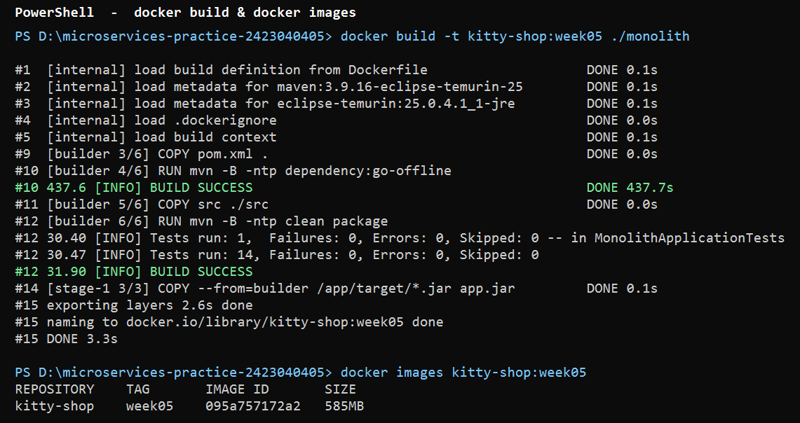
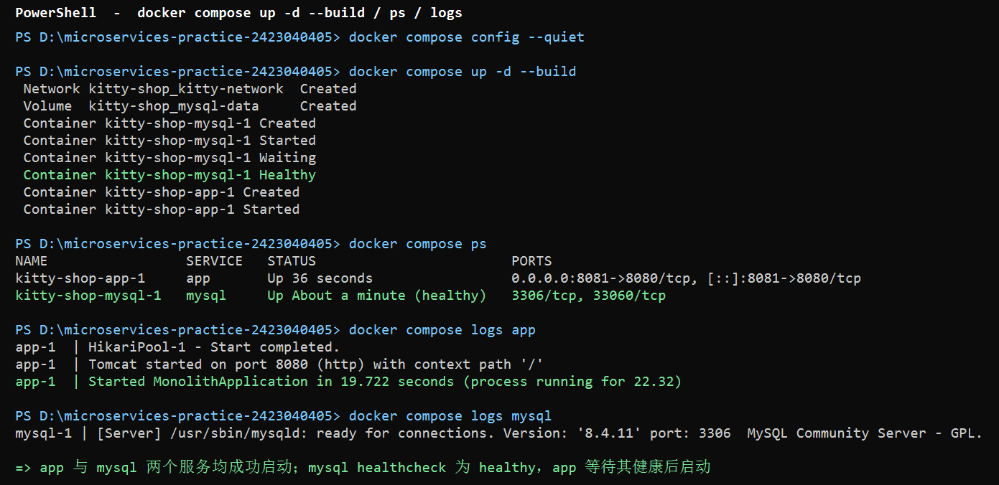
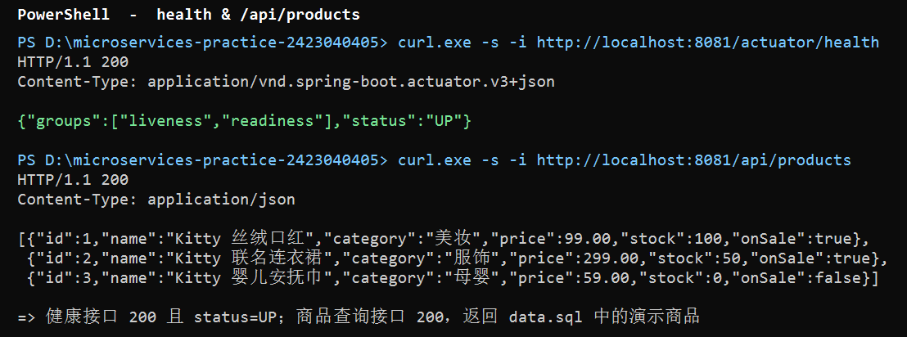
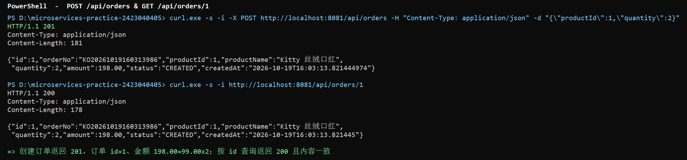
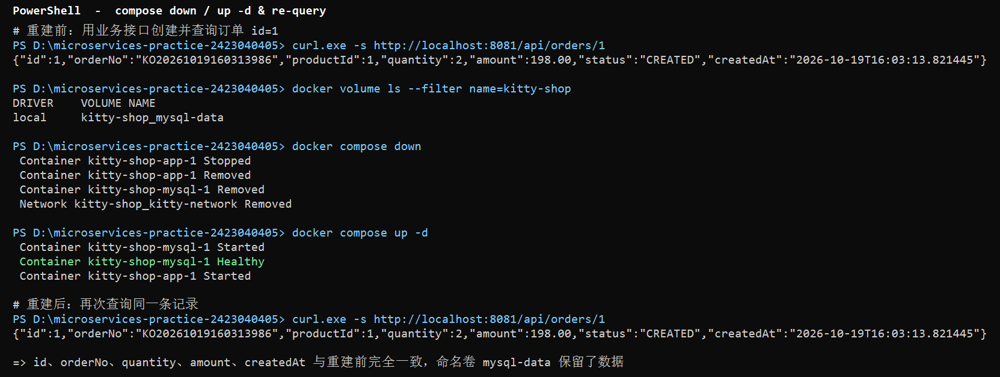

# 第 05 周作业记录：单体应用与 MySQL 容器化

本周把 `monolith/` 单体工程（Kitty 蜜选电商系统）与 MySQL 数据库容器化，实现可重复的
镜像构建、Compose 一键启动、业务 API 验证与数据持久化。**未修改上周任何代码或配置**：
应用连接数据库改用 Spring Boot 环境变量（`SPRING_DATASOURCE_*`）覆盖，因此
`monolith/src/main/resources/application.yaml` 保持原样。

## 提交文件清单

| 文件 | 位置 | 说明 |
| --- | --- | --- |
| [Dockerfile](file:///d:/microservices-practice-2423040405/monolith/Dockerfile) | `monolith/` | 多阶段构建 |
| [.dockerignore](file:///d:/microservices-practice-2423040405/monolith/.dockerignore) | `monolith/` | 构建上下文忽略规则 |
| [compose.yaml](file:///d:/microservices-practice-2423040405/compose.yaml) | 仓库根目录 | app + mysql 编排 |
| [.env.example](file:///d:/microservices-practice-2423040405/.env.example) | 仓库根目录 | 环境变量模板 |
| [.gitignore](file:///d:/microservices-practice-2423040405/.gitignore) | 仓库根目录 | 忽略真实 `.env` |

---

## 一、Dockerfile 与镜像构建

### 实现思路

`Dockerfile` 采用**多阶段构建**，分为两个阶段：

- **构建阶段 `builder`**：基于 `maven:3.9.16-eclipse-temurin-25`，先 `COPY pom.xml` 并执行
  `mvn dependency:go-offline` 预下载依赖（利用 Docker 层缓存），再 `COPY src` 执行
  `mvn clean package`，产出 Spring Boot 可执行 JAR。
- **运行阶段 `runtime`**：只基于 `eclipse-temurin:25.0.4.1_1-jre`，从构建阶段
  `COPY --from=builder` 拷贝最终 JAR 作为 `app.jar` 启动。

多阶段构建的作用：**构建工具（Maven + JDK）只存在于构建阶段，最终运行镜像只保留 JRE 与 JAR**，
镜像更小、攻击面更小；同时构建完全在容器内完成，**本机无需安装 Maven 或 Java**。

`.dockerignore` 排除了 `target/`（本机构建产物）、`.idea/`、`*.iml`、`.vscode/`、
`.env*`（密码文件）以及 `*.md`/`*.log` 等无关内容，减小构建上下文并避免敏感信息入镜像。

### 运行命令

```bash
# 在仓库根目录执行，构建上下文为 ./monolith
docker build -t kitty-shop:week05 ./monolith

# 查看镜像
docker images kitty-shop:week05
```

### 结果

镜像构建成功。构建阶段运行了上周的 14 个单元测试（H2 内存库）全部通过：

```
#12 [INFO] Tests run: 14, Failures: 0, Errors: 0, Skipped: 0
#12 [INFO] BUILD SUCCESS
#15 naming to docker.io/library/kitty-shop:week05 done
```

| 项 | 值 |
| --- | --- |
| 镜像名 | `kitty-shop:week05` |
| IMAGE ID | `095a757172a2` |
| 大小 | 585 MB |
| 构建阶段基础镜像 | `maven:3.9.16-eclipse-temurin-25` |
| 运行阶段基础镜像 | `eclipse-temurin:25.0.4.1_1-jre` |

### 截图



---

## 二、Compose 编排与启动

### 实现思路

根目录 `compose.yaml`（不使用已废弃的 `version` 字段）定义两个服务，项目名 `kitty-shop`：

| 服务 | 镜像 / 构建 | 关键配置 |
| --- | --- | --- |
| `mysql` | `mysql:8.4.11` | 命名数据卷 `mysql-data:/var/lib/mysql`；healthcheck 用业务账号对业务库执行 `SELECT 1` |
| `app` | `build: context: ./monolith`，镜像 `kitty-shop:week05` | 端口映射 `${APP_PORT}:8080`；`depends_on: mysql(condition: service_healthy)` |

- **服务连接方式**：两个服务接入同一 `kitty-network` 网络，应用通过**服务名** `mysql:3306`
  连接数据库（`jdbc:mysql://mysql:3306/${MYSQL_DATABASE}`），无需暴露本机 3306 端口。
- **环境变量**：库名、账号、密码来自 `.env`；Compose 以 `SPRING_DATASOURCE_URL`、`SPRING_DATASOURCE_USERNAME`、
  `SPRING_DATASOURCE_PASSWORD` 注入应用，覆盖 `application.yaml` 中的本机连接配置。`.env.example`
  提供模板，真实 `.env` 已加入根目录 `.gitignore`，不提交密码。
- **健康检查与启动顺序**：`mysql` 健康检查通过后 `app` 才启动，避免应用先于数据库就绪而连接失败。

### 运行命令

```bash
# 复制模板并填写密码
Copy-Item .env.example .env      # Linux/macOS: cp .env.example .env

docker compose config --quiet     # 校验配置
docker compose up -d --build      # 一键构建并启动
docker compose ps                 # 查看状态
docker compose logs --tail=50 app # 查看应用日志
docker compose down               # 停止（保留命名数据卷）
```

### 结果

两个服务均成功启动（`docker compose ps`）：

```
NAME                 SERVICE   STATUS                        PORTS
kitty-shop-app-1     app       Up 36 seconds                 0.0.0.0:8081->8080/tcp
kitty-shop-mysql-1   mysql     Up About a minute (healthy)   3306/tcp, 33060/tcp
```

应用日志显示 `Tomcat started on port 8080`、`Started MonolithApplication in 19.722 seconds`。

> **端口说明**：本机 8080 已被其他进程占用（`com.docker.backend` / `wslrelay`），
> 故 `.env` 中 `APP_PORT=8081`，下文请求地址均用 `http://localhost:8081`；
> 若本机 8080 空闲，保持 `.env` 默认 `APP_PORT=8080` 即可。

### 截图



---

## 三、个人业务 API 验证

沿用上周实现的商品下单业务，通过容器映射到本机的端口（8081）验证：

| # | 方法与路径 | 说明 | 预期 | 实际 |
| --- | --- | --- | --- | --- |
| 1 | `GET /actuator/health` | 健康检查 | 200，`status=UP` | 200 `{"groups":["liveness","readiness"],"status":"UP"}` |
| 2 | `GET /api/products` | 查询商品列表 | 200 | 200，返回 `data.sql` 的 3 条演示商品 |
| 3 | `POST /api/orders` | 下单（创建） | 201 | 201，见下 |
| 4 | `GET /api/orders/{id}` | 查询订单详情 | 200 | 200，内容与创建一致 |

**创建**请求（商品 1，数量 2）：

```bash
curl -i -X POST http://localhost:8081/api/orders \
  -H "Content-Type: application/json" \
  -d "{\"productId\":1,\"quantity\":2}"
```

响应 `201`：`{"id":1,"orderNo":"KO20261019160313986","productId":1,"productName":"Kitty 丝绒口红","quantity":2,"amount":198.00,"status":"CREATED",...}`
（金额 198.00 = 单价 99.00 × 数量 2，库存同步扣减）。

**查询**订单详情返回 `200`，与创建结果一致。接口状态码与上周业务规则完全一致。

### 截图





---

## 四、数据持久化验证

### 验证方法

1. 用业务接口创建一条订单（`POST /api/orders`，商品 1、数量 2），得到 `id=1`；
2. 查询该订单确认存在（重建前基线）；
3. 执行 `docker compose down`（**不加 `-v`**，保留命名数据卷）；
4. 执行 `docker compose up -d` 重建容器；
5. 待 `mysql` 健康、应用启动完成后，再次查询同一条记录。

```bash
curl http://localhost:8081/api/orders/1        # 重建前
docker compose down                            # 保留命名数据卷
docker compose up -d                           # 重建容器
curl http://localhost:8081/api/orders/1        # 重建后
```

### 结果

重建前后返回**完全相同**：

```
{"id":1,"orderNo":"KO20261019160313986","productId":1,"quantity":2,
 "amount":198.00,"status":"CREATED","createdAt":"2026-10-19T16:03:13.821445"}
```

`id`、`orderNo`、`quantity`、`amount`、`createdAt` 均未变化，说明数据仍保存在 MySQL 中。

**命名数据卷的作用**：`mysql-data` 挂载到容器的 `/var/lib/mysql`，MySQL 的数据文件实际
存放在该卷中。`docker compose down` 只删除容器与网络，**不会删除命名卷**，因此重建容器后
数据仍在。若使用 `docker compose down -v` 会连同数据卷一起删除，数据将丢失（本项验证未使用）。

### 截图



---

## 五、可复现性小结

- 镜像构建完全在容器内完成，本机无需 Maven/Java；`docker build -t kitty-shop:week05 ./monolith` 可重复执行。
- `docker compose up -d --build` 一键启动 app 与 mysql，应用等待数据库健康后启动。
- 业务接口（健康检查、商品查询、下单创建、订单查询）在容器环境下与上周表现一致。
- `docker compose down` 后重新 `up -d`，数据仍保留，验证了命名数据卷的持久化能力。

### 截图目录

`docs/homework/week-05/screenshots/`：

| 文件 | 对应环节 |
| --- | --- |
| `01-镜像构建.png` | Dockerfile 镜像构建与 `docker images` 查看 |
| `02-compose启动.png` | `docker compose up -d --build` / `ps` / 日志 |
| `03-api健康与商品.png` | 健康接口 + 商品查询接口 |
| `04-api下单与查询.png` | 下单创建（201）+ 订单查询（200） |
| `05-数据持久化.png` | 容器重建前后数据查询对比 |
