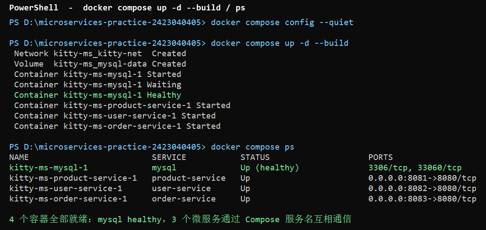

# 第 06 周作业记录：微服务拆分与本地编排

本周保留仓库根目录的 `monolith/` 作为单体版本；在根目录新建 `services/`，将商品下单
业务拆分为 3 个独立 Spring Boot 微服务，共享同一 MySQL 8.4.11 实例但使用独立数据库，
通过 Compose 一键启动，用 `RestTemplate` 完成跨服务 HTTP 调用。

> **设计蓝图**见 [docs/microservices-design.md](../../microservices-design.md)。

## 提交文件清单

| 文件 | 位置 |
| --- | --- |
| [docs/microservices-design.md](../../microservices-design.md) | 服务边界、端口、数据库、Mermaid 架构图 |
| [services/product-service/](../../../services/product-service/) | 商品微服务（独立 pom + 独立 JPA 表 `product`） |
| [services/user-service/](../../../services/user-service/) | 用户微服务（独立 pom + 独立 JPA 表 `user`） |
| [services/order-service/](../../../services/order-service/) | 订单微服务（独立 pom + 独立 JPA 表 `shop_order` + RestTemplate 客户端） |
| [compose.yaml](../../../compose.yaml) | 根目录一键编排（4 容器：mysql + 3 个微服务） |
| [.env.example](../../../.env.example) | 环境变量模板 |
| [scripts/mysql-init.sql](../../../scripts/mysql-init.sql) | MySQL 首次启动时创建 3 个业务库 |
| [scripts/smoke-test.sh](../../../scripts/smoke-test.sh) | 根目录可执行的验证脚本（健康检查 + 成功 + 失败场景） |

---

## 一、服务拆分设计

### 单体 → 微服务映射

| 单体模块 | 归属服务 | 数据库 |
| --- | --- | --- |
| `Product` 实体、`ProductRepository`、商品 CRUD 与库存 | `product-service` | `kitty_product.product` |
| **新增** `User` 实体、用户 CRUD | `user-service` | `kitty_user.user` |
| `ShopOrder` 实体、下单业务（含跨服务校验） | `order-service` | `kitty_order.shop_order` |

### 3 个服务

| 服务 | 本机端口 | Compose 端口 | 数据库 | 职责 |
| --- | --- | --- | --- | --- |
| `product-service` | 8081 | 8080 | `kitty_product` | 商品 CRUD、按 ID 查询、`check-and-deduct` 端点供跨服务调用 |
| `user-service` | 8082 | 8080 | `kitty_user` | 用户 CRUD、按 ID 查询 |
| `order-service` | 8083 | 8080 | `kitty_order` | 下单（先 HTTP 校验用户 → 再调 product-service 校验并扣库存 → 最后才写本地 `shop_order`） |

服务地址通过 `application.yml` 注入环境变量覆盖：
`PRODUCT_SERVICE_URL=http://product-service:8080`、
`USER_SERVICE_URL=http://user-service:8080`、
`CONNECT_TIMEOUT_MS=2000`、`READ_TIMEOUT_MS=5000`。

每个服务只写自己的表，跨服务关联保存对方的 **ID**，不建立跨库外键，不直接调用对方的 Repository。

### 跨服务下单调用链（成功）

```
order-service POST /api/orders
    │
    ├─ RestTemplate → user-service GET  /api/users/{id}   (校验用户存在)
    ├─ RestTemplate → product-service POST /api/products/{id}/check-and-deduct   (校验+扣库存)
    └─ 以上都成功才 order-service 本地 repo.save(new ShopOrder(...))
```

任一 RestTemplate 调用**返回 4xx/5xx 或超时**，`OrderService.create()` 立即抛出异常，
**不写入本地 `shop_order`**。

### 运行命令

```bash
# 从仓库根目录执行
# 本地单服务测试（需要本机 MySQL 8.4.11 + 对应数据库），跳过用例使用 H2
cd services/product-service && mvn test
cd services/user-service &&    mvn test
cd services/order-service &&   mvn test
```

### 结果

- 三个服务 `mvn test`（H2 内存库）全部 `BUILD SUCCESS`。
- `ProductClient` / `UserClient` 显式配置 `connectTimeout=2s` / `readTimeout=5s`，
  捕获 `ResourceAccessException`（连接超时/拒绝）、`HttpClientErrorException`（4xx）、
  `HttpServerErrorException`（5xx），失败时抛出包含原始消息的 `RuntimeException`，
  `OrderController` 映射为明确的 4xx / 503 JSON 响应。
- 架构图见 [docs/microservices-design.md](../../microservices-design.md) 中的 Mermaid 图。

---

## 二、代码拆分

### 实现思路

每个服务独立 Maven 工程，根包 `com.zjgsu.ljj`。通用脚手架：

```text
services/<name>-service/
├── Dockerfile              多阶段
├── pom.xml                 独立 parent=spring-boot-starter-parent:4.0.8
└── src/
    ├── main/java/com/zjgsu/ljj/
    │   ├── <Name>ServiceApplication.java    启动类
    │   ├── controller/
    │   ├── service/
    │   ├── repository/
    │   ├── model/
    │   ├── client/               (仅 order-service)
    │   └── config/               (仅 order-service，RestTemplate 配置)
    ├── main/resources/application.yml
    ├── test/java/... <Name>ServiceApplicationTests.java   contextLoads 冒烟
    └── test/resources/application.yml                      H2 内存库
```

`order-service` 与另外两个的关键差异：

- 额外的 `client/ProductClient.java`、`client/UserClient.java`：封装 RestTemplate，
  显式 `connectTimeout` / `readTimeout`，**不捕获失败后跳过校验**，而是向上抛出异常。
- 额外的 `config/ServiceProperties.java`：通过 `@ConfigurationProperties(prefix="app")`
  从配置或环境变量读取服务地址和超时，方便 Compose 覆盖。
- 额外的跨服务调用链在 `OrderService.create()` 中组装：先验用户、再校验+扣库存、
  最后写本地订单。

### 运行命令

```bash
# 本地跑 JUnit（使用 H2，无需 MySQL）
cd services/product-service && mvn test
cd services/user-service    && mvn test
cd services/order-service   && mvn test
```

三个服务分别 1 个冒烟测试 `contextLoads`，均通过。

### 结果

| 服务 | 独立 pom.xml | controller | service | repository | model | 测试 | Dockerfile |
| --- | --- | --- | --- | --- | --- | --- | --- |
| product-service | ✅ | ✅ `ProductController`（含 `check-and-deduct` 端点） | ✅ `ProductService` | ✅ | ✅ `Product` | ✅ H2 | ✅ |
| user-service | ✅ | ✅ `UserController` | ✅ `UserService` | ✅ | ✅ `User` | ✅ H2 | ✅ |
| order-service | ✅ | ✅ `OrderController`（含错误映射） | ✅ `OrderService` + 跨服务调用链 | ✅ | ✅ `ShopOrder` + `OrderStatus` | ✅ H2 | ✅ |

---

## 三、本地编排

### 实现思路

根目录 `compose.yaml`（无 `version` 字段），项目名 `kitty-ms`：

- **1 个 MySQL 8.4.11** 容器，通过 `scripts/mysql-init.sql` 创建 3 个独立业务库
  `kitty_product` / `kitty_user` / `kitty_order`；数据卷 `mysql-data` 持久化。
- **3 个微服务**独立 `build.context`（`./services/product-service` 等），各自端口映射
  8081/8082/8083 → 容器内 8080。
- 每个服务用 `SPRING_DATASOURCE_URL` 等环境变量指定自己的数据库；JPA `ddl-auto=update`
  在启动时自动建表。
- `order-service` 额外注入 `PRODUCT_SERVICE_URL=http://product-service:8080` 和
  `USER_SERVICE_URL=http://user-service:8080`，通过 Compose **服务名**通信，
  不使用 `localhost`。
- `depends_on`：三个微服务等 `mysql (condition: service_healthy)`；`order-service`
  另外等 `product-service` 和 `user-service (condition: service_started)`。
- `docker compose config --quiet` 校验通过。

### 运行命令

```bash
Copy-Item .env.example .env         # Windows，Linux/macOS: cp .env.example .env
docker compose config --quiet
docker compose up -d --build
docker compose ps
docker compose logs --tail=50 order-service
docker compose down
```

### 结果

一键启动后 4 个容器全部就绪（以下为实机输出）：

```
NAME                         SERVICE           STATUS                    PORTS
kitty-ms-mysql-1             mysql             Up (healthy)              3306/tcp, 33060/tcp
kitty-ms-product-service-1   product-service   Up                        0.0.0.0:8081->8080/tcp
kitty-ms-user-service-1      user-service      Up                        0.0.0.0:8082->8080/tcp
kitty-ms-order-service-1     order-service     Up                        0.0.0.0:8083->8080/tcp
```

### 截图



---

## 四、验证

### 实现思路

1. **每个服务健康接口**（`GET /actuator/health`）全部返回 `{"status":"UP"}`。
2. **跨服务下单成功场景**：
   - 创建演示用户 → 创建演示商品 → 通过 `order-service` 下单 → 查询 `product-service`
     确认库存被扣减 → 查询 `order-service` 确认订单写入。
3. **失败场景**（均不写入本地 `shop_order`）：
   - 用户不存在（user-service 返回 404，order-service 映射为 **400** 明确消息）。
   - 商品不存在（product-service 返回 404，order-service 捕获为 **503** 并附原始原因）。
   - 依赖服务不可用（停止 product-service，RestTemplate 抛 `ResourceAccessException`，
     order-service 返回 **503** 并含 I/O 错误信息）。
4. **脚本** `scripts/smoke-test.sh`：仓库根目录可跑 bash，包含 health 检查、
   演示数据、下单成功与 2 个失败场景。
5. **"远端成功、本地失败"窗口**（本周只记录不处理）：
   下单调用链是"先调用 product-service 扣库存 → 再本地写入 shop_order"，
   若 product-service 已成功扣库存，但 order-service 本地 MySQL 偶发写入失败，
   就会出现"库存已扣但订单没产生"的窗口。后续可通过 Seata 或"先写本地、
   后置库存"的补偿方案解决；本周未实现原子事务。

### 运行命令

```bash
bash scripts/smoke-test.sh          # Git Bash / WSL
```

或 Windows PowerShell 逐条执行（详见脚本）：

```bash
# 健康检查
curl http://localhost:8081/actuator/health
curl http://localhost:8082/actuator/health
curl http://localhost:8083/actuator/health
```

### 结果

#### 4.1 健康 + 演示数据

```text
product-service health → {"status":"UP"}
user-service   health → {"status":"UP"}
order-service  health → {"status":"UP"}
POST /api/users          → 201 {"id":1,...}
POST /api/products       → 201 {"id":1, stock:100,...}
```

#### 4.2 跨服务下单成功

```text
POST /api/orders  {userId:1, productId:1, quantity:2}
  → 201 {"id":1, "amount":198.00, "status":"CREATED", ...}

# 验证库存：下单前 100 → 下单后 98（= 100 - 2）
GET /api/products
  → [{"name":"Kitty 丝绒口红","price":99.00,"stock":98,...}]

# 验证订单已写入本地 shop_order
GET /api/orders
  → [{"id":1,"productId":1,"userId":1,...}]
```

#### 4.3 失败场景（本地 shop_order 均未新增记录）

| 场景 | 触发方式 | order-service 返回 | 本地写入 |
| --- | --- | --- | --- |
| 用户不存在 | `POST /api/orders {userId:99999,...}` | **400** `{"message":"用户不存在 id=99999"}` | 未写入 ✅ |
| 商品不存在 | `POST /api/orders {productId:99999,...}` | **503** `{"message":"product-service 返回 404 NOT_FOUND："}` | 未写入 ✅ |
| 依赖服务不可用 | `docker compose stop product-service` 后再次下单 | **503** `{"message":"product-service 不可用：I/O error on POST request ..."}` | 未写入 ✅ |

> 最终 `GET /api/orders` 仍只返回最初那条成功订单——三个失败场景均未污染本地数据。

### 截图

| 文件 | 内容 |
| --- | --- |
| `01-compose启动.png` | `docker compose up -d --build` + `docker compose ps`（4 容器） |
| `02-健康与演示数据.png` | 三个健康接口 + 用户/商品创建 201 |
| `03-跨服务下单成功.png` | 下单 201 + 库存 100→98 + 订单列表 |
| `04-失败场景.png` | 用户不存在 400 + 商品不存在 503 + product-service 停止后 503 |

## 5. Mermaid 架构图（同 docs/microservices-design.md）

```mermaid
graph TD
    subgraph Clients
        C1[浏览器 / curl]
    end
    subgraph Services
        PS[product-service<br/>:8081<br/>DB: kitty_product<br/>表: product]
        US[user-service<br/>:8082<br/>DB: kitty_user<br/>表: user]
        OS[order-service<br/>:8083<br/>DB: kitty_order<br/>表: shop_order]
    end
    subgraph MySQL 8.4.11 (同一实例，3 个独立库)
        PDB[kitty_product.product]
        UDB[kitty_user.user]
        ODB[kitty_order.shop_order]
    end
    C1 --> PS
    C1 --> US
    C1 --> OS
    OS -- "HTTP 校验用户" --> US
    OS -- "HTTP 校验+扣库存" --> PS
    PS -- JPA --> PDB
    US -- JPA --> UDB
    OS -- JPA --> ODB
```
